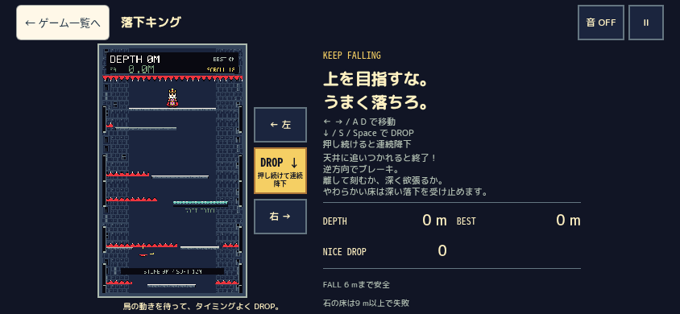
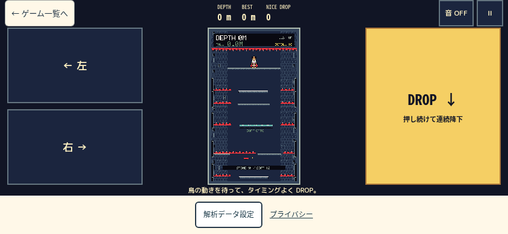
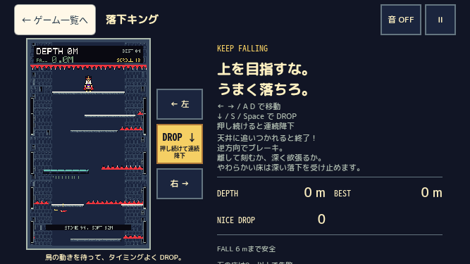
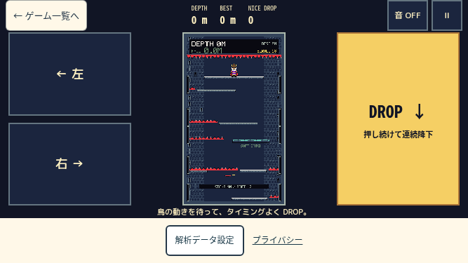
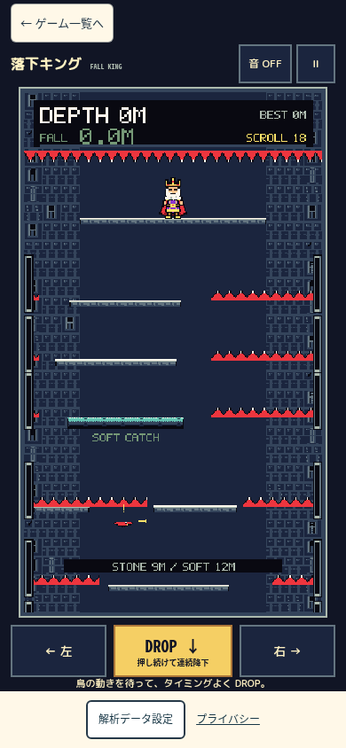
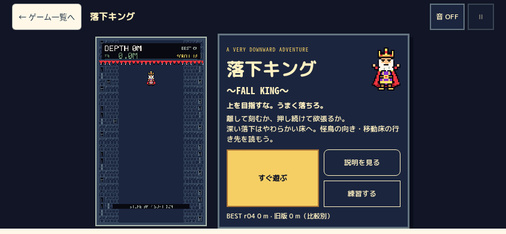
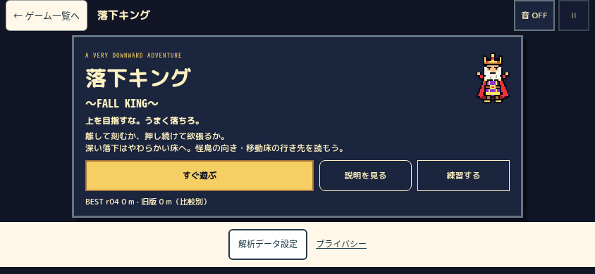
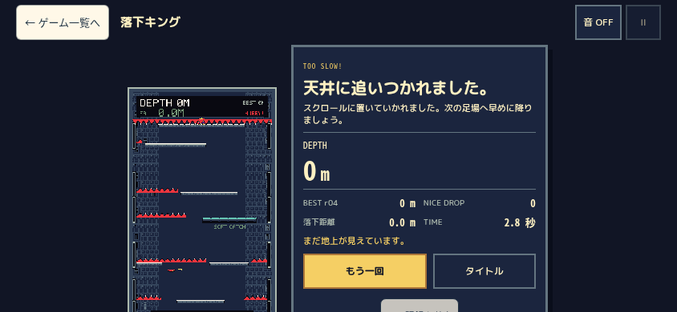
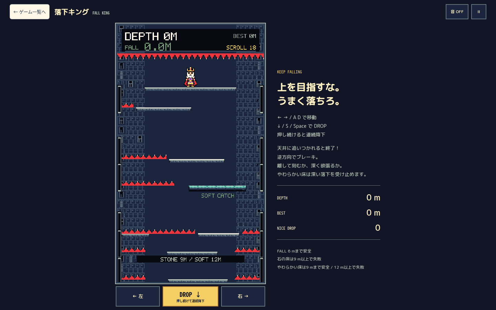
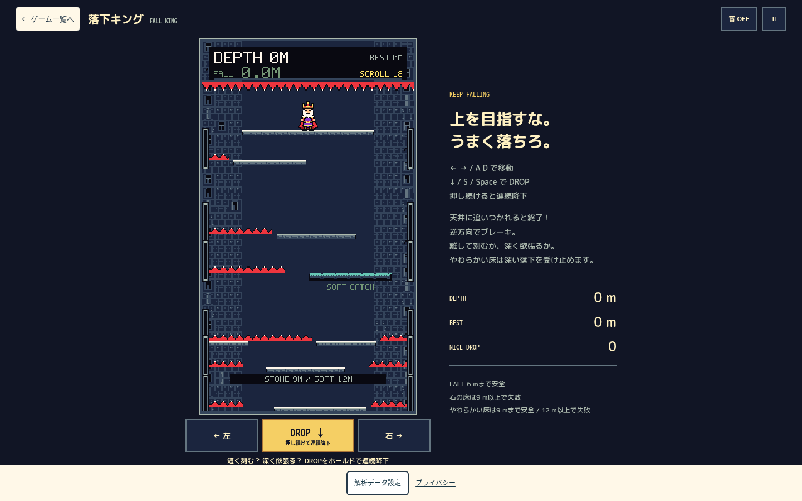

# Game015 スマホ縦横UI改修 — 実装・ローカル検証報告

2026-10-20 JST：作者の実機評価でスマホ横向きプレイを不採用とし、縦画面専用方針へ変更。最新仕様と検証は [縦画面専用化報告](mobile-ux/portrait-only/IMPLEMENTATION_REPORT.md) を参照。以下の横向き改修は当時の履歴として保持する。

**2026-10-20の最新追加修正は [表示012 iPhone入力対策](mobile-ux/iphone-input/IMPLEMENTATION_REPORT.md) を参照。** PR #11の中央配置を保持し、長押し選択と欠落終端の解除経路を強化。Safari実機の真因/快適性は未確認。

**現行の改訂版は [PR #11 改訂2](mobile-ux/revision2/IMPLEMENTATION_REPORT.md) を参照。** 作者の視覚レビューを反映し、Canvas高を844で314px・667で299pxへ回復。以下は初版85d6fa9時点の記録で、初版の技術成功を作者の承認とは扱わない。初版はその後GitHub保存・Draft PR #11作成済み。

対象は `game015.html` / 落下キング ～FALL KING～。Game012・013のGodotや、表示番号による別作品ではない。
基準main: `47c6cfe1ea93f71325fc47ff7031980ef9be9f74`（Phase 1 PR #10統合後）。
作業枝: `codex/game015-mobile-landscape-ux`。既存作業を維持した独立worktree `/workspace/arcade-game015-mobile`。
**本番未公開・main未変更。iPhone Safari実機での作者確認待ち。**

## A. 修正前の問題分析

### 確認した事実

- `.fall-board` は縦並び、Canvasの下に左・DROP・右の3ボタン。短い横画面では長押し操作が画面下に集まっていた。
- Canvasの高さを `100dvh - 153px` 等の定数で決めていた。ヘッダー、説明、操作、ステータス、既存の解析設定フッター（実測64px）全体の高さを配分できていなかった。
- 844×390ではCanvasが173.70×304px、playingの縦はみ出し83px。667×375では165.14×289px・98px。PC1440×900も78pxはみ出した。
- 横画面の説明欄は短縮されていても同じレイアウトに残り、844幅では353px相当の説明領域を持っていた。
- 入力のup/cancel/blur解除は既存実装にある一方、resize/orientationchange、捕捉した指が画面外へ移動した際の明示解除と、保持中の見た目が不足していた。
- 共通onboardingの短い横画面CSSは `dialog[data-phase='practice'] { display:grid }`。閉じたdialogにも適用され、`open=false`になっても画面が残る既存不具合を通常タップで再現した。開始ボタンが覆われる。Game015のCSSだけで閉状態を明示非表示にした。

### 修正前の証拠

[全7サイズ・5状態のDOMRect](mobile-ux/QA/before/layout.json)、[入力RED](mobile-ux/QA/input-red-corrected.log)。入力REDは既存コードに新しい11テストを適用して5失敗・6成功。最初のDOMアダプター不足による失敗は症状のREDに数えていない。

### 縦向きポータル

390×620、375×520、320×440の可視領域で、通常スクロールによるカード・記録・PLAY・about/privacy・末尾到達、OR/AND選択・お気に入りを確認。横はみ出し0、27カード維持。ポータルの縦スクロールは一覧の本来の動作であり、ゲーム中のはみ出しと区別した。**ポータルのコード/CSSは変更していない。** Safariの実ブラウザバー自体は未検証。

## B. 設計方式の比較

|方式|実装・保守|性能・リスク|判断|
|---|---|---|---|
|A: 既存CSSの固定高・余白だけ調整|小規模だが端末/フッターごとの定数が増える|追加JSなし。全体の高さ配分や両側配置が複雑|不採用|
|B: CSS Grid + media query + container単位|Canvas用wrapper1つ。状態別の配分をGame015内に閉じる|追加ライブラリ・毎フレーム計測なし。DOMのHUDを再利用|採用|
|C: JSでvisualViewportを監視しサイズ設定|複数バー/回転/キーボードの監視と解除が必要|レイアウトread/write、イベント管理が増える|今回は不要|

採用: bodyが実viewportと既存フッターを配分し、app内はヘッダー/残り領域、横画面は操作/縦長Canvas/DROPのGrid。`100vh → 100svh → 100dvh` のフォールバックを置き、Canvasはコンテナーの幅・高さの小さい制約へ合わせる。container単位未対応時はdvh式へフォールバック。古いSafariの実挙動は未検証。

## C. 修正内容と保護範囲

|ファイル|変更|
|---|---|
|`game015.html`|viewport-fitをcoverへ。余白はGame015 CSSの4辺safe-areaで確保|
|`src/games/game015/style.css`|状態/縦横/高さに応じたGrid、押下表示、pauseヘルプ、閉dialog非表示|
|`src/games/game015/FallBoard.ts`|Canvas用wrapper、保持表示、空白誤入力防止、画面外/回転/resizeの入力解除|
|`src/games/game015/main.ts`|既存説明文を再利用する一時停止「遊び方」detailsのみ|
|`tests/unit/game015-input-ui.test.ts`|実コントローラに対する入力回帰11件|
|`tests/game015/mobile-ux/`|通常のブラウザ操作/DOMRect/可視領域/ポータル検証スクリプト|
|`docs/game015/`・`docs/CURRENT_STATUS.md`|実装、証拠、レビューと再開情報|

### 配置・状態

- 横向きplaying/ending: 左手側に上下2つの左/右ボタン、中央に4:7のCanvas、右手側に大きなDROP。DOM上のbutton ID/ラベル/キーの意味は維持。
- DEPTH/BEST/NICEは元のHTMLのdlをヘッダー中央へ配置し、IDや毎フレーム更新先を複製しない。左に一覧、右に音/一時停止。Canvas内部の描画も維持。
- 縦向きでは操作をCanvas下へ。DEPTH/BESTは既存のCanvas内HUDで確認し、横向きはHTML HUDで読みやすく補助する。PCは右側300pxの説明と従来の操作配置を保持し、Canvasの高さだけ残り領域に収めた。
- 長文はモバイルplaying/endingで非表示。タイトルの説明/練習と、一時停止の「遊び方」から読める。PCの説明文を削除していない。
- title/paused/resultは通常のページフローで必要ならスクロールできる。短い横画面では背景用previewステージを省き、メニューを優先。
- 指を離す/cancel/lostcapture/blur/停止/回転/resizeで保持を解除。画面外へ出た指は戻っても再押下まで復活しない。回転でゲームの時計/深度は初期化しない。
- `data-held` の更新は入力イベント時のみ。tick/paint/物理/描画解像度/画像/音/スコア/保存キー/RecordSharing/Telemetry/Analytics/CREDITは変更なし。
- `FallRun.ts`、生成、art、types、保存処理、カタログ、共通CSS、広告、ads.txt、privacy、Worker/D1、Pages設定、他ゲームの本体に差分なし。

## D. 修正前後の比較

数値はCSS px。横スクロールは全ケースで0。縦はplayingのdocument高さ−viewport高さ。

|viewport|Canvas 修正前 → 修正後|縦はみ出し 前 → 後|左/右ボタン 修正後|DROP 修正後|
|---|---|---|---|---|
|390×844|358×626.50 → 335.53×587.20|41 → 0|107.69×58.80|134.61×58.80|
|375×667|277.70×486 → 234.39×410.20|78 → 0|103.06×58.80|128.86×58.80|
|320×568|221.14×387 → 177.83×311.20|78 → 0|86.14×58.80|107.70×58.80|
|844×390|173.70×304 → 142.84×250|83 → 0|225.14×126|225.16×262|
|932×430|196.56×344 → 165.70×290|64 → 0|250.28×146|250.30×302|
|667×375|165.14×289 → 134.28×235|98 → 0|174.56×118.5|174.58×247|
|1440×900|426.84×747 → 380.11×665.20|78 → 0|130.45×58.80|163.08×58.80|

Canvasの面積を増やしたという結果ではない。従来は画面外まで使っていたため、フッターを残したまま全画面を収めると高さは減る。中央の縦長表示、常時触れる両側操作、同時に読めるHTML HUDを優先した。4:7と内部256×448・pixelatedは維持。最小横画面のゲーム内小文字の読みやすさ/Canvasの大きさは実機で判断する。

|同じviewport・状態|修正前|修正後|
|---|---|---|
|844×390 playing|||
|667×375 playing|||
|390×844 playing|||
|844×390 title|||
|844×390 paused|||
|844×390 result|||
|1440×900 playing|||

同じ状態で撮影した通常操作の実画像。ランごとの深度/結果値の完全同期は行っていない。初回afterでHUDがGrid自動配置により下へ落ちた問題を発見し、ヘッダーの明示row/column指定で修正した。改善後画像はその修正を含む。閉dialog修正は通常5状態の寸法には影響せず、最終compiled検証でも同じ寸法を確認済み。

## E. 検証結果

|検証|結果・証拠|
|---|---|
|型検査|`npm run check` 成功。[ログ](mobile-ux/QA/check-complete.log)|
|単体全体|106ファイル/1,122件成功（従来1,111 + 入力11）。[ログ](mobile-ux/QA/test-complete.log)|
|入力RED/GREEN|修正前5失敗/6成功 → 修正後11成功。[GREEN](mobile-ux/QA/input-green.log)|
|ビルド|`npm run build` 成功。既存の大きいchunk警告は残る。[ログ](mobile-ux/QA/build-complete.log)|
|offline Jev|25件成功。API課金なし。[ログ](mobile-ux/QA/jev-offline.log)|
|状態/寸法|最終compiled buildで7サイズ×title/playing/paused/ending/resultを取得。playing/endingの縦横はみ出し0、Canvas/操作見切れなし。横向き/PCのHTML HUDと縦向きのCanvas HUDを確認。[DOMRect](mobile-ux/QA/after/layout.json)|
|ブラウザ機能|7サイズ×23チェック=161成功。[結果](mobile-ux/QA/functional.json)|
|二本指・画面外|native CDP touchStart/Endで左右+DROP同時保持/個別解除、捕捉中の画面外移動/再入場も確認。[結果](mobile-ux/QA/extras.json)|
|可視領域変化|844×300/390、390×620/760/844へ変化。初期化なし、縦横はみ出し0|
|safe area|CDP `setSafeAreaInsetsOverride` で左右47/下21px。computed padding反映、playing縦横0、pause help/再開を確認。実Safariではない|
|ポータル|3狭幅×縮小高で通常スクロール、絞り込み・お気に入り・記録・末尾リンク到達。変更不要|
|JS例外/通信|機能161チェックの全7contextでpageerror0、GET/HEAD以外の送信0。localhost以外のリクエストはabort。本番Telemetry/広告クリックなし|
|性能|新しい毎フレームDOM処理、Canvas再生成、viewport監視、依存追加なし。独立レビューとソース差分で確認。実機FPS/タッチ遅延は未測定|

機能検証は、左/右、DROP短押し/長押し/解除、native cancel、blurイベント、回転相当resize、pause/resume、実モデル終局/遅いrelease、retry/title/list、実得点のBEST保存/リロード、独立練習、PCキーを含む。blurのみwindowイベントのfixture注入、回転はviewport交換であり端末センサーではない。ゲームの状態/得点を注入して終了を偽装していない。DEVの既存readonly snapshotを観測に使用。

初回全体テストは省容量のsparse worktreeに既存fixture（Jev profile、Workerソース/SQL、006過去モデル等）が無く失敗した。HEADから必要ファイルを復元し、Worker対象テスト26成功を確認後、全体1,122成功。製品やテスト期待値を変更して回避していない。最初のcollectorのselector誤選択/未対応CDPメソッドは修正し、製品不具合と区別した。

### 再現手順

```bash
npm ci
npm run check
npm test
npm run build
# 端末から届く開発機で起動（本番公開ではない）
npm run dev -- --host 0.0.0.0 --port 4931
# 別ターミナル、Chromiumを利用可能にする
QA_BASE=http://127.0.0.1:4931/ node tests/game015/mobile-ux/functional.mjs
QA_BASE=http://127.0.0.1:4931/ node tests/game015/mobile-ux/extras.mjs
QA_PHASE=after QA_BASE=http://127.0.0.1:4931/ node tests/game015/mobile-ux/layout.mjs
```

`QA_CHROMIUM` で実行ファイル、`QA_OUT` で出力先を指定可能。layoutはcompiled静的配信にも使える。functional/extrasのモデル観測にはDEVが必要。保存JSONはDOMRectと必要なsnapshot数値の投影で、全platform/hazard配列は原始証拠へ保持。実測画面は [QA](mobile-ux/QA/) に保存。稼働中プロセスだけに成果を依存させていない。

### 独立レビュー / Shadow

[独立コード・画像・操作レビュー](mobile-ux/INDEPENDENT_REVIEW.md)で実装者と判定を分離。Visual83/100（F12/15、H13/15）。独立した通常操作でも667/1440の移動・DROP・pause/help/resume、compiled844の練習終了→fresh PLAYを確認。自動操作の成立を人間の操作性/面白さの合格とは扱わない。今回、有料APIは禁止のためJev実APIは未実施。通常の独立調査・限定修正・回帰とoffline helper25件で確認し、Jevスコア/費用/回答を創作しない。

## F. 作者のiPhone実機チェック（公開前）

- [ ] 同じWi-Fiの開発PCで上記devを起動し、iPhone Safariから `http://開発PCのLANアドレス:4931/game015.html` を開く。
- [ ] 端末を両手で横持ちし、左親指で左右、右親指でDROPを押す。ボタン/Canvasの大きさと誤押下を判断する。
- [ ] 左右+DROPを同時保持し、片方を離しても残りが意図通り続く。DROPを短く刻む/長押しする操作を比較する。
- [ ] 指を画面外へ滑らせ、戻す/離す/新しく押す。保持残り・意図しない再スタートがない。
- [ ] アドレスバー/下部バーの展開・縮小、ノッチ/ホームインジケータ、音、長時間FPSと発熱を確認する。
- [ ] 押下中に縦横回転し、時計/深度が初期化されず、次の新しい押下で操作できる。
- [ ] 一時停止の遊び方を読んで再開。終局後の記録/再挑戦/一覧帰還、Safari再読込後のBESTを確認する。
- [ ] 小型横画面でCanvas内文字・床/針/鳥の判別、中央HUDの読みやすさを確認する。
- [ ] ポータル縦画面で全カード/PLAY/末尾のabout/privacyに通常スクロールで到達する。

これらは未実施。Windows/ChromiumエミュレーションをiPhone実機の合格に読み替えない。作者の承認後に、別タスクでmain統合・公開を行う。

## GitHub保存・費用・公開境界

- PUBLICリポジトリを実照会。既存PR validationは `ubuntu-latest` 1ジョブ、npm cacheのみ、artifact/Packages/LFS追加・有料API・外部deployなし。Pagesはmain push/manualのみで今回起動しない。
- cache使用量は97,333,639 bytes（2件）。ワークフローや課金設定を変更しない。
- Webhook一覧APIは403。外部連動による費用の有無はUNKNOWN。以前の「費用不明ならpush前で停止」の制限を維持し、この不明点の明示承認なしにpushを実行しない。
- commitはローカル保存でありGitHubへのバックアップではない。保存先は上記worktree、原始ログ/全画像は `/workspace/audits/game015-mobile-20261019/`。
- main merge/push、Pages deploy、AdSense再申請、Phase 2、他ゲームへの展開は未実施。
