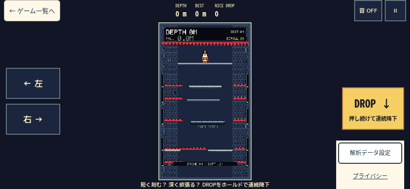
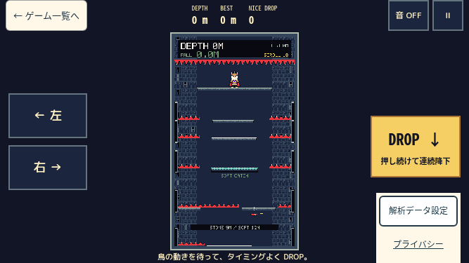
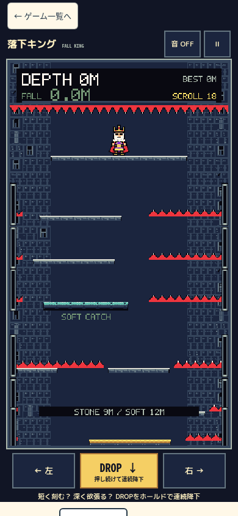
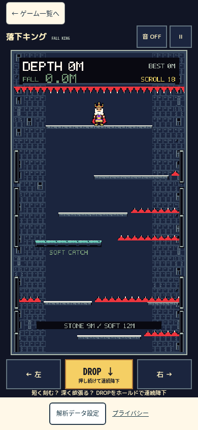
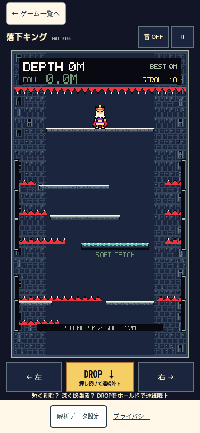
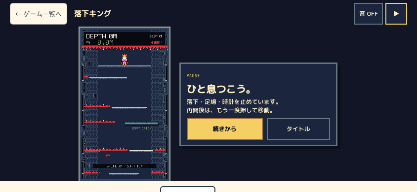
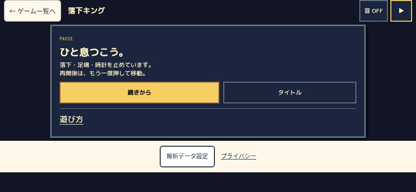
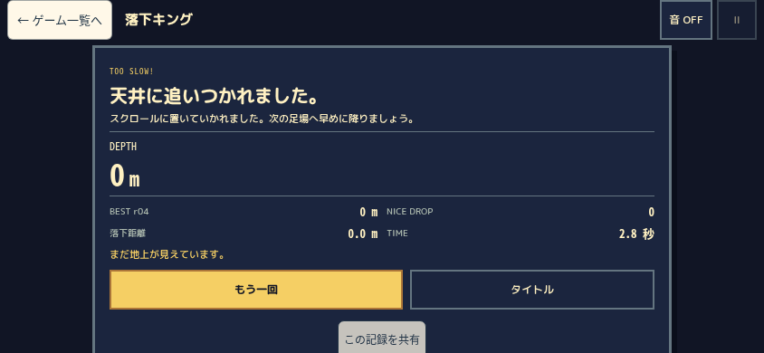
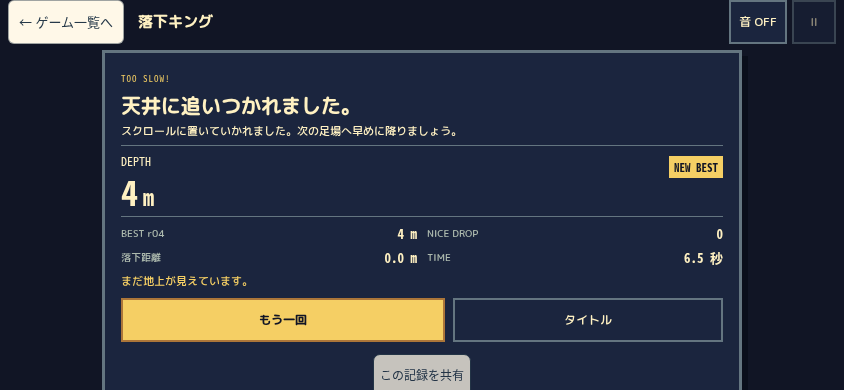

# 表示012「落下キング」iPhone入力対策 — PR #11追加修正

2026-10-20 JST。対象は **表示012 / 内部game015 / game015.html**。表示013は内部game016「負けじゃんけん」で対象外。内部game012/013のGodotとは別作品。

基準: 最新main `47c6cfe1ea93f71325fc47ff7031980ef9be9f74`、PR #11修正前HEAD `e88245a9ce92c5aed3e1b1b990c4ee0cfddff5b9`。両方のカタログをDEVで読んで番号対応を照合。本番HTML/CSSをHTTP取得し、最新Pages成功もmain47c6cfeであることを確認した。**PRは未公開で、本番の左寄せレイアウトは残っている。**

既存枝 `codex/game015-mobile-landscape-ux` / Draft PR #11を継続。物理・難易度・得点・保存・Analytics/Telemetry・広告・他ゲームを変更しない。

## A. 原因と確度

|問題|確認済み|UNKNOWN / 判定|
|---|---|---|
|長押し文字選択|作者が本番iPhoneで観測。本番CSSには操作用user-select/touch-callout抑止なし。PRにはbutton用抑止が既にある。pointerdownのpreventDefaultはmainにもある|今回のChromiumでは作者のOS選択/コピーUIを再現できず、Safariの実際のイベント順序・原因はUNKNOWN。CSS欠落だけが真因だと断定しない|
|離しても移動|main/PRのpointer終端はwindow bubble依存、明示capture解除・touch終端fallbackなし。PR修正前でpointerupとlostcaptureを故意に遮ると、native touchend後もhorizontal=-1が残るREDを再現|これは故障注入による因果確認。実iPhoneが同じ2イベントを失ったという証明ではない|
|Canvas幅の揺れ|main/PRを10条件（844/667/390/320＋667safe-area）・140サンプルで計測。固定CSS/visual viewport時のCanvas x/y/幅/高さの変化は全て0。短文/長文の既存statusを同期描画する表示fixtureでも0|本番Safariで観測された揺れの原因はUNKNOWN。viewport/bar/zoomの実機ログなし。status折返し→container寸法変動の仮説も今回の条件では確認できず、不必要なレイアウト改修はしない|
|横向き左寄せ|現在の本番mainはCanvas左＋右説明欄。PR e88245aは既にCanvas中央・左右別の操作・プレイ中の長文省略を実装済み|今回はその成果を維持し、重複実装しない。main未公開との違いを明示|

`visibilitychange` はページmain側で既にpause経由の解除がある。今回のコントローラ側追加を、本番にvisibility解除が全くなかったかのようには報告しない。

参考: [修正前の入力/viewport計測](QA/before-summary.json)、[同期status表示fixture](QA/status-fixture.json)、[pointer終端故障注入RED](QA/browser-red.json)。Safari実機のイベント診断ログは未取得。

## B. 修正内容

### FallBoard.ts — 入力の終了経路

- 有効pointer IDごとのcapture所有者とtouch由来IDを管理。従来の方向Map/DROP Set/keyboard Mapは保持。
- document captureでpointerup/pointercancelを観測。他UIがbubbleを止めても終端処理できる。window終端処理も互換用に維持。
- pointerup/cancel/lostcaptureで該当IDだけ解除。owner/入力Mapを先に消してからreleasePointerCaptureするため、lostcaptureが再入しても冪等。
- pause/end/title/retry/blur/resize/orientation/destroyで全入力とcaptureを解除。document.hidden時もコントローラ単独で解除する。位置/速度/深度/時計を初期化しない。
- touchend/touchcancelでactive touchが0なら、登録済みtouch由来のpointer保持だけ解除。keyboard/mouseは維持。Touch.identifierをpointerIdと同一視しない。
- pointermoveでbuttons=0またはviewport外を検出した場合も該当IDを解除。画面内へ戻しただけでは再入力しない。
- keyupをcaptureで受け、Shadow UIのbubble抑止で既存のキー保持が残ることを防ぐ。
- contextmenu/selectstartの抑止をプレイ中の操作/Canvasに限定。Text node起点も親Elementへ正規化し、既知pointerIdがある場合は該当pointerだけを解除し、同じボタンの別の指も維持。IDのないgeneric selectionは影響する操作だけを安全に解除。
- **長押し秒数で切るタイムアウトは追加していない。** tick/paint/物理/得点/保存処理は不変。

全touch終了fallbackは、他の指が残る間に消えた特定pointerのIDを推測しない。通常の個別終端はcaptureで処理し、終端欠落が重なった場合は最後のtouch終了で確実に中立へ戻す方式。全ての終端/フォーカスイベントをOSが渡さない状況まで確認したものではない。

### style.css — 選択抑止

`.fall-controls`、全子要素、Canvasだけに user-select / -webkit-user-select / -webkit-touch-callout / touch-action を設定。通常説明、pause help、privacy、about、リンクや他ゲームに全体抑止をかけない。保持表示のborder幅や配置寸法は変えない。

### 非変更

`main.ts`、`game015.html`、ゲームモデル/生成/アート/音、BEST/保存形式、RecordSharing、カタログ、内部game012/013、表示013=game016、Analytics/Telemetry、CMP/AdSense/ads.txt、Worker/D1、Pages設定は今回の追加差分なし。前工程で承認したPR #11の変更は保持する。

## C. 検証

- 既存11件の入力テストを残し追加。最初の修正前REDは10失敗/11成功。[RED](QA/input-red.log)
- Text node起点の選択についても追加REDを確認。[追加RED](QA/text-node-red.log)
- 同一ボタン上の別の指を保持するcalloutの追加REDも確認。[同一操作RED](QA/same-control-red.log)。最終入力24件、全体1,135件/106files、check/build成功。CI結果はGitHub PR検証で別途確認する。[入力](QA/input-final.log) / [全体](QA/test.log) / [型検査](QA/check.log) / [ビルド](QA/build.log)
- 対象6サイズで新しい通常タッチ/キー回帰171項目成功。[結果](QA/browser.json)
- pointer終端2種をwindow captureで遮る故障注入でも、実touchendから中立復帰。修正前PRでは同じ手順がRED。OSでの自然再現と区別。
- 左/右同時、左右＋DROP、片方だけ解除、cancel、実gotcapture後の明示release、画面内で別ボタンへ指を動かす/画面外へ移動、localized synthetic contextmenu/selectstart、回転、blur、pause/resume、キーボードを確認。
- 左/右3秒と左10秒のnative holdは通常終局を含む。途中のending/resultで保持が残らず、遅いreleaseで再開しないことを確認。**10秒間のactive gameplayを確認したという意味ではない。** コントローラ単体ではRAFを止めたfixtureで3/10秒保持→解除を確認し、タイムアウトを導入していない。
- hidden解除とkeyboard/touch混在・同一/複数pointerの冪等性は実コントローラの単体テストで確認。物理端末のアプリ切替は未実施。
- 固定viewport内のbefore/down/保持中（約100–120ms間隔）/up/解除後で、Canvas x/y/幅/高さの最大差0px。画面スクロール描画とDOM寸法を区別。全frameのSafari挙動やブラウザバー変化まで保証しない。[寸法系列](QA/input-rects.ndjson) / [修正前系列](QA/before-rects.ndjson)
- 画面の高さが実際に変わればdvhに応じて再配置する既存仕様は維持。固定サイズの乱用、!important追加、viewport監視ループ、毎フレームDOM再構築なし。
- 既存機能テスト161項目（7サイズ×23）も再実行。終了・再挑戦・title/list・実BEST保存/再読込・独立練習・PCキー・例外0を確認。結果は [functional.json](QA/functional.json)。
- compiled7サイズ×5状態のplaying/ending縦横はみ出し0。[DOMRect](QA/layout.json)
- すべてlocalhostで実施し、外部通信を遮断。本番Telemetry、広告クリック、データ変更なし。

### Safari/WebKitの限界

Playwright WebKitの実行ファイルが環境になく、空き容量約150MiBのため既存作業を保護してエンジン導入はしていない。**WebKit未実施、実iPhone Safari未実施。** ChromiumのタッチエミュレーションをSafari相当合格とは扱わない。[記録](QA/WEBKIT.json)

独立担当によるコード/実画像/3画面の通常操作でも技術的blockerなし。[独立レビュー](INDEPENDENT_REVIEW.md) に保存。Jev有料APIは利用せず、既存offline helperを確認。自動操作・過去Visual点は作者の快適性判定を代行しない。

## D. main / PR修正前 / 今回の比較

単位CSS px。現在mainとPR基準SHAが前回保存時と一致するため、A/B画像は同じSHAの保存済み実画像を再利用。新しい入力計測は両方のGitソースを隔離DEVで再実行した。Cは固定した最終ソースを独立担当が撮影（844/667はDEV、390はcompiled）。compiled全7サイズの寸法も別途確認した。ランの値・敵の位置は完全同期していない。

|viewport|版|Canvas 幅×高さ|左/右|DROP|縦はみ出し|
|---|---|---|---|---|---|
|844×390|A 本番main|173.70×304|66×44|66×57.19|83|
|844×390|B PR e88245a|179.42×314|112×64|128×88|0|
|844×390|C 今回|179.42×314|112×64|128×88|0|
|667×375|A 本番main|165.14×289|66×44|66×57.19|98|
|667×375|B PR e88245a|170.84×299|112×64|128×88|0|
|667×375|C 今回|170.84×299|112×64|128×88|0|
|390×844|A 本番main|358×626.50|102.77×58.80|128.45×58.80|41|
|390×844|B PR e88245a|335.53×587.20|107.69×58.80|134.61×58.80|0|
|390×844|C 今回|335.53×587.20|107.69×58.80|134.61×58.80|0|

横はみ出しは全ケース0。今回CはBの見た目・Canvas面積を維持した入力修正である。横向きのheader44px、Canvas y=52から844では366、667では351まで、状態文と枠用に下24pxを残す。解析設定/プライバシーは右下の44px以上の操作領域を維持。[3版DOMRect](QA/comparison.json)

|同一viewport/state|A 本番main|B PR修正前|C 今回|
|---|---|---|---|
|844×390 playing||||
|667×375 playing||||
|390×844 playing||||
|844×390 paused||||
|844×390 result||||

## E. 再現・Git・公開境界

```bash
npm ci
npm run check
npm test
npm run build
npm run dev -- --host 0.0.0.0 --port 4931
# 別ターミナル
QA_BASE=http://127.0.0.1:4931/ node tests/game015/mobile-ux/iphone-input.mjs
QA_BASE=http://127.0.0.1:4931/ node tests/game015/mobile-ux/functional.mjs
```

`iphone-input.mjs` はDEVの既存readonly snapshotでモデルへ渡る方向/保持を観測。得点/位置/結果を書き換えない。外部通信は遮断する。QA_CASE=lostで終端故障注入だけ実行できる。

既存PR #11に追加commit・通常push、Draftを維持する。既存標準PR検証だけを利用し、main merge/push・Pages公開・AdSense再申請は行わない。保存場所は `/workspace/arcade-game015-mobile`、原始ログは `/workspace/audits/game015-iphone-20261020`。

## F. 作者のiPhone試遊

**本番URLはまだ旧版。今回の対策確認にはPR版を使用する。** PCの別フォルダでPRブランチを取得し、上記devを同じWi-Fiから開く（`http://PCのLANアドレス:4931/game015.html`）。

1. 表示012「落下キング」か確認。左/右を各3秒、可能なら安全な場面で10秒保持→離す。選択/コピーUIと入力残りを確認。
2. 押したままボタン外・画面外へ滑らせ、離す。新しく押すまで再入力されないか確認。
3. 左右同時、左右＋DROPで片方だけ離す。残る指だけが有効になり、最後の指で中立になるか確認。
4. 押下中に縦横回転、Safariバー展開/縮小、他アプリへ切替→戻る。入力残りがなく、新しい押下で操作できるか確認。
5. pause/再開・終局直後のrelease・retry・title/list・BEST再読込を確認。
6. 固定向きでボタンを交互に押し、Canvas DOMの幅/位置が揺れないか確認。再現する場合は端末/Safari版・向き・アドレスバー状態・画面録画を記録する。
7. 解析設定・拒否/撤回・privacy・通常の説明選択が使えるか確認。表示013は改修していない。

物理端末で再現が残る場合はUNKNOWNを維持して診断を追加し、現段階で「Safari完全解決」「公開可」とは断定しない。
