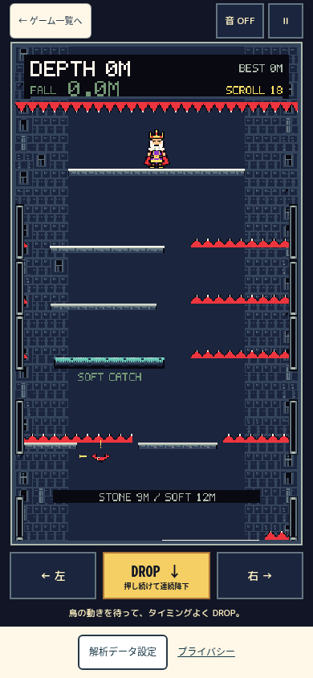
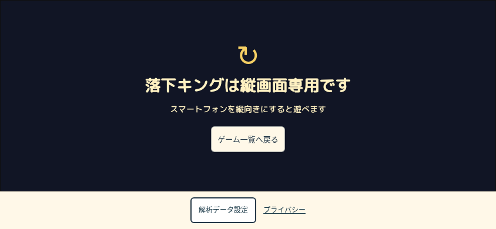
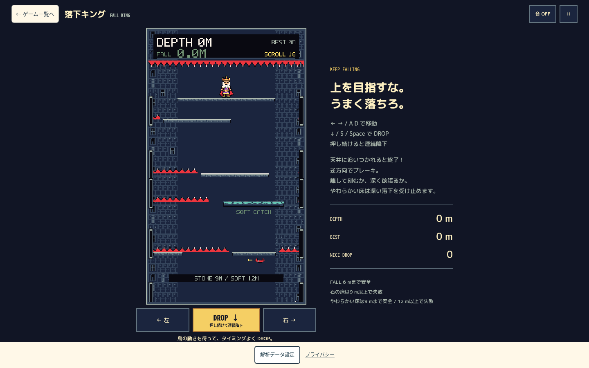

# 表示012「落下キング」— スマホ縦画面専用化

2026-10-20 JST。表示012＝内部 `game015`＝`game015.html`。既存Draft PR #11／`codex/game015-mobile-landscape-ux` を継続する。開始時local／remote HEADは `62ac47215e4ae137184f51484b47405078d795b0`、mainは `47c6cfe1ea93f71325fc47ff7031980ef9be9f74`。未コミット変更なし、最新mainとPR枝をfetchして照合した。

**作者の実機判断に従い、スマホ横向きプレイは不採用。今後は縦画面を正式なスマホ版とする。** 過去の横向き比較・入力診断は履歴として保持する。今回はmain統合／本番公開を行わず、作者のiPhone試遊・公開承認を待つ。

## 実装と状態保持

- `portrait.ts` のMediaQueryListで入力特性とviewportを判定する。向き固定API、PWA、フルスクリーン、UA判定、viewport監視ループは使わない。
- 制限条件は **primary pointer:coarse、hover:none、landscape、幅≤1000px、高さ≤600px** の全て。fine-pointerのPC、縦画面、大きなタブレットは除外する。
- 横向きには「落下キングは縦画面専用です」「スマートフォンを縦向きにすると遊べます」と一覧へ戻るリンクを表示。ゲーム本体は非表示＋inertにし、案内へfocusを移す。解析設定とプライバシーは通常footerとして利用できる。
- playingから横向きになると既存pauseを1回だけ呼ぶ。入力／captureを解除し、位置・速度・足場・天井・時計を保存したまま止める。縦へ戻ってもpausedを維持し、「続きから」の新しい操作だけで再開する。
- ending中は400msの結果表示待ちの残時間と演出clockを止め、戻った際に残りの待ちだけ再開する。記録完了・BEST更新は既存の1回だけ。正規の終了を取消したり重複させたりしない。
- title／paused／resultはその状態を保持。回転の両側で既存gesture epochを進め、回転前に押したmenu／練習buttonの遅いclickを持ち越さない。
- 練習と説明はnative dialog内にあるため、共有onboardingにowner用 `setSuspended(boolean)` を追加した。Game015だけが呼ぶ。active／session／callback／phase／DOMを保持し、入力Mapとcaptureを消してnative dialogを一時的に閉じる（既存の終了関数は呼ばない）。説明・成功画面は元の画面へ、練習は「続きから」を追加して停止状態へ戻る。再開時に時刻基準を更新し、横向き時間の追いつき計算をしない。回転だけでtutorial／practice開始・完了イベントを新たに送らない。
- 共有APIを呼ばない他ゲームは通常経路を維持する。新しいcapture所有者管理はGame015の練習入力だけに使用する。

### 判定の限界

上記は**端末識別ではなくヒューリスティック**。1000×600を超える大きなスマホ表示、primary pointer特性が変わるマウス接続・アクセシビリティ設定、小型touch PC／タブレットの小窓、キーボードによるviewport変化などは実機確認が必要。スマホ横向きの操作layoutへfallbackして保守する方針ではない。実機で誤判定があれば、端末・Safari版・CSS／visual viewport・pointer／hover結果を採取して判定条件を見直す。

## CSSと入力の保護

- スマホ横向き専用の3列Grid、左右の縦積み、巨大DROP配置、上段の外側HUD、右説明欄、解析設定の右下固定配置を削除した。
- 縦プレイのheaderは戻る・音・停止を1段に集約。重複タイトルを省き、既存Canvas内HUDを利用する。左／DROP／右は下部のまま、各44px以上。4:7、256×448、pixelated、DROP holdを維持。
- 縦プレイはsafe-areaとdynamic viewport、実際のfooter高を引いた残りの領域でCanvasを収める。statusは2行分の高さを確保し、入力による文言の長短でCanvas面積を変えない。title／説明／結果は通常の縦スクロールを許す。
- PCは従来のCanvas＋右guide。短いPCウィンドウでは通常Gridの行を残高に収め、説明欄だけ必要に応じてスクロールする。スマホ用の横操作layoutは復活させない。
- `FallBoard.ts` は前候補から**バイト一致**。選択／callout抑止、pointer ID、document capture終端、個別pointer解除、lostcapture、最後のtouchend fallback、blur／hidden、押下feedbackを保持した。共有onboardingの練習にも所有captureの安全な解除を追加した。
- 入力中立と慣性を区別する。停止・解除のために位置や速度を上書きせず、ゲーム物理を変えていない。

## 検証

修正前HEAD62ac472で、縦プレイ→844×390への回転後にpausedにならないREDを記録した。[RED](QA/red.json)

- `npm run check` 成功。[log](QA/check.log)
- `npm test` **1,137件／107files成功**。既存入力24件を保持、MediaQueryListの初期状態／変更／解除を2件追加。[log](QA/test.log)
- `npm run build` 成功。既存の大きなchunk警告あり、閾値やbuild設定は変更しない。[log](QA/build.log)
- DEVブラウザ：指定7viewport＋fine-pointer844×390＋touch tablet1024×768、**9条件224項目成功**。回転中の全snapshot一致、明示再開、run_start／run_end／BESTの非重複、練習時計／状態保持、説明復帰、自然終了／結果保持、endingの待機停止、解析設定とprivacyを確認。[結果](QA/browser.json)
- compiled7条件80項目、入力回帰4条件115項目、既存機能4条件95項目も成功。[検証一覧](QA/SUMMARY.json)／[compiled](QA/compiled.json)／[入力](QA/input.json)／[機能](QA/functional.json)。compiledにはDEV診断hookが存在しない。safe-area20/34、縦height620/760/844、通常帰還、現行active Game005の共有練習とGame016起動も確認した。
- 入力回帰は左／右3秒・左10秒のnative holdを含む。ただし通常ゲームの自然終了を含み、10秒間のactive gameplayを保証したという意味ではない。入力24件の単体fixtureでは3／10秒の保持と解除を確認。固定viewportのplayingサンプルでCanvas x/y/幅/高さのrangeは全て0px。[系列](QA/input-rects.ndjson)
- テスト基盤の旧仕様・曖昧selector等の修正は [collector記録](QA/COLLECTOR_NOTES.md) に区別。失敗原本を削除せず `/workspace/audits/game015-portrait-20261020/` へ保持する。
- 全ブラウザ操作はlocalhost、外部通信遮断。本番Telemetry・広告クリック・本番データ変更なし。Jev等の有料APIは利用しない。
- 製品ソースを固定して検証し、[SHA256](QA/SOURCE_HASHES.json) と [独立レビュー](INDEPENDENT_REVIEW.md) を保存する。

共有練習の成功画面を開いた状態での回転はブラウザ未実施。コード上のDOM／phase保持と実行済みの説明／練習保持を区別する。

### WebKit／実機

**実iPhone Safari未実施、WebKit未実施。** 環境にWebKit実行ファイルがなく、既存作業を保全するため容量不足下で新規導入しない。Chromiumのtouch／safe-area／viewportエミュレーションを実Safari合格とは扱わない。実アドレスバー・アプリ切替・OSの長押しUIは作者確認待ち。

固定viewportのタッチ系列でCanvas幅／高さ／位置を検査するが、前工程でUNKNOWNだった実Safariの幅揺れの真因が確定したという意味ではない。

## 画面

|viewport|今回のCanvas高／表示|操作|
|---|---|---|
|390×844|615.20px|左／DROP／右を下部、文書overflow 0|
|375×667|438.20px|同上|
|320×568|339.20px|同上|
|844×390／932×430／667×375 touch|縦向き案内|ゲームはinert・停止、設定と帰還は利用可能|
|1440×900 fine|665.20px|従来PC構成|
|844×390 fine|155.20px|制限対象外、通常PC構成の説明欄だけscroll|
|1024×768 touch|533.20px|大型tabletは制限対象外|

縦3サイズはいずれも前候補よりCanvas高+28px、PC1440は同じ。寸法はCSS px・safe-area 0で測定。safe-areaを上20／下34にした390幅と、縦viewport高620／760／844も別途確認した。全ての実機条件を表す値ではない。以前の表示用part属性は互換用に保持するが、旧横向き固定配置は利用しない。

縦390×844（compiled）:



横844×390（compiled）:



PC1440×900（compiled）:



その他の指定幅、safe-area、縦戻りpause、自然結果はQAのscreensと原始画像に保存する。

## 変更範囲と保存

製品：`src/games/game015/main.ts`、`style.css`、新規 `portrait.ts`、共有 `src/arcade/onboarding.ts`（Game015 ownerの中断とGame015練習captureのみ）。

テスト：`tests/unit/game015-portrait.test.ts`、`tests/game015/mobile-ux/portrait.mjs`、`portrait-compiled.mjs`、既存 `iphone-input.mjs`／`functional.mjs` の現在方針への回帰更新。過去の横向き比較collectorと成果物は履歴として保持する。

文書：本報告／QA／独立レビュー、Game015の入口報告、CURRENT_STATUS。

物理／難易度／落下速度／衝突／得点／BEST保存形式／RecordSharing／CREDIT、Telemetry・Analytics送信仕様、AdSense／CMP、Worker／D1、他ゲームの製品コード、ポータル、公開設定、mainは変更しない。

ローカル：`/workspace/arcade-game015-mobile`。原始ログ：`/workspace/audits/game015-portrait-20261020`。既存Draft PR #11へ追加commit・通常pushし、標準PR検証だけを確認する。main merge／push、Pages公開、auto merge、AdSense再申請、paid API／サービス追加は行わない。

## 作者のiPhone試遊手順

**本番は旧版。PRの縦専用候補をローカルで取得して試す。** PC上の既存作業を保持するため別worktreeを使う例:

```sh
git fetch origin codex/game015-mobile-landscape-ux
git worktree add --detach ../fallking-portrait origin/codex/game015-mobile-landscape-ux
cd ../fallking-portrait
npm ci
npm run dev -- --host 0.0.0.0 --port 4941
```

同じWi-FiのiPhoneで `http://PCのLANアドレス:4941/game015.html` を開く。

1. 縦向きで表示012「落下キング」を開始。左／右3秒、可能な場面で10秒、DROP長押し、左右＋DROPで1本ずつ離す。選択UIと入力残りを確認。
2. 入力中に横へ回転。案内・入力解除・時計／落下の停止を確認。しばらく待って縦へ戻し、pauseのままであることを確認。「続きから」で進行を引き継ぐ。
3. title・説明・練習・結果で回転。練習は「続きから」を押すまで止まり、step／BEST／プレイ回数に重複がないか確認。回転前に押したbuttonの離しが別操作にならないか確認。
4. Safariバーの展開／縮小、notch／home indicator、アプリ切替・復帰後の新しい押下を確認。固定向きでCanvasの幅が揺れる場合は画面録画とviewport情報を記録する。
5. 横向きでも解析設定・拒否／撤回・プライバシー・一覧への帰還を確認。通常説明を選択できることを確認。
6. PCでも通常プレイできること、マウス接続iPhone／タブレット等で判定が適切かを確認。誤判定はUNKNOWNのまま採取する。

作者の実機試遊と公開承認を待つ。今回の自動検証を公開承認やSafariの完全解決とみなさない。
