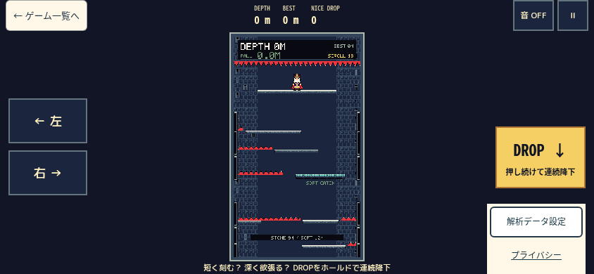

# PR #11 改訂2 — 横向きCanvasを優先した配置

対象: Game015「落下キング」、既存枝 `codex/game015-mobile-landscape-ux`、既存Draft PR #11。
基準: PR初版 `85d6fa9d3917f9cbedadb922c04778d48514cb38`。修正前はmain `47c6cfe`。
作者の視覚レビューで、初版のCanvas縮小は体験上不十分と判断された。初版の技術チェック/Visual点は作者の承認を意味しない。この改訂も**作者の実機・視覚レビュー待ち、本番未公開**。

## 結果

- 844×390のCanvas高 **304 → 250 → 314px**、667×375は **289 → 235 → 299px**。修正前比どちらも+10px、初版比+64px。
- 縦横比4:7、内部256×448、pixelatedを維持。Canvasを切り取ったり、ページを縮小表示した数値ではない。
- 左/右は各112×64px、DROPは128×88px。Canvas・操作・HTML HUD・解析設定・プライバシーが同じ可視領域に収まる。
- 解析設定UIは削除せず、横向きplaying/ending時だけ右下の空き領域へ移す。設定ボタン/プライバシーリンクは2段、それぞれ44px以上。同意/撤回/初回表示の既存処理を維持。

## 設計比較

|案|高さと操作への影響|保守/リスク|判断|
|---|---|---|---|
|64pxの全幅フッターを維持し、余白だけ短縮|最小44pxヘッダーと枠/状態文を残すと、初版の64px分の縮小を回復できない|小変更だがCanvas優先を満たしにくい|不採用|
|設定リンクをヘッダーへ横並び|ヘッダーの高さを増やさず置ける場合もある|667幅やsafe-areaでは一覧/DEPTH/BEST/音/停止と競合。Shadow内部余白も必要|不採用|
|**右下の空き領域に2段で配置**|Canvasと重ならずフッターの全幅64pxを解放。設定/プライバシーを直接操作できる|Shadowの表示用part2個のみ追加。Game015固有CSSから利用|**採用**|
|設定をpause/menuのみに隠す|プレイ面積は増える|アクセスの手間が増え、初回unknown/撤回導線の扱いも変わる|不採用|

Shadow DOMの `.settings` は元々折返しなしで、hostの幅だけ縮めると崩れる。このため `part="settings"` と `part="privacy-link"` を既存マークアップに加えた。共通のCSS・文言・イベントハンドラー・ConsentServiceには変更を加えていない。Game015以外は従来の全幅64px/横並びのまま。

host幅は120px以上を確保し、568×320でも設定文の不要な折返しと枠外へのはみ出しを防ぐ。hostをtransform/containせず固定配置し、元の設定パネルは引き続きviewport基準のfixed/中央/自然スクロール。パネルを開くとゲーム上へ表示される点は既存仕様であり、閉状態の重なりとは区別する。広告同意との関係やAnalyticsの意味を変更しない。

## 配置と余白

- 横向きヘッダーは初版の44pxを維持。これ以上縮めると一覧・音・停止の44px操作領域を損なうため維持する。
- 両端の極端に広い操作を縮小。左/右は上下間隔10px、DROPと解析設定枠は22px離す。Canvasは中央に維持。
- app左右8px、board左右4px。Canvasはy=52pxから、844では366px、667では351pxまで見える。画面下の残り24pxは枠/余白と既存の状態文16px。
- 状態文の幅も左右のUI領域を除いて制約し、長文がプライバシーリンクと重ならないようにする。文言/更新の意味は変えない。
- 解析設定枠: 844では140×100px、667では120.05×100px。画面高全体を占めず、右下で直接操作できる。下端はsafe-area内側へ追従。
- title/paused/result・縦向き・PCは従来フローへ戻る。解析設定UIの省スペース化は横向きplaying/ending限定。

## 同じviewportでの3段階比較

単位CSS px。左/右は同寸法。縦はみ出しはdocument高さ−viewport高さ。

|viewport|段階|Canvas 幅×高さ（y範囲）|左/右|DROP|ヘッダー高|解析設定領域|縦はみ出し|
|---|---|---|---|---|---|---|---|
|844×390|修正前main|173.70×304（60–364）|66×44|66×57.19|56|全幅×64、y409.25で画面外|83|
|844×390|PR初版|142.84×250（52–302）|225.14×126|225.16×262|44|全幅×64、y326–390|0|
|844×390|今回改訂|179.42×314（52–366）|112×64|128×88|44|右下140×100、y290–390|0|
|667×375|修正前main|165.14×289（60–349）|66×44|66×57.19|56|全幅×64、y409.25で画面外|98|
|667×375|PR初版|134.28×235（52–287）|174.56×118.5|174.58×247|44|全幅×64、y311–375|0|
|667×375|今回改訂|170.84×299（52–351）|112×64|128×88|44|右下120.05×100、y275–375|0|

全段階で横はみ出し0。修正前はCanvas自体が収まっていても設定UIなどが画面外だった。改訂版は操作や設定導線を画面外へ追い出して高さを増やしていない。
[3段階のDOMRect](QA/comparison.json)、[最終7サイズ×5状態](QA/layout.json)、[Shadow内部の寸法・同意回帰](QA/consent.json)。

|viewport|修正前main|PR初版|今回改訂|
|---|---|---|---|
|844×390 playing||||
|667×375 playing||||

同じviewport・playing状態の通常操作による実画像。ランの進行時刻/床や鳥の位置は完全同期していない。

## 変更ファイル・非変更

- `src/games/game015/style.css`: 横向きボタン寸法、解析設定枠/partの配置、状態文幅のみ。
- `src/analytics/consentUI.ts`: 既存マークアップに表示用part属性2個のみ追加。デフォルトのスタイル/イベント/文言は不変。
- `tests/game015/mobile-ux/revision2.mjs`: Canvasの目標高、重なり、44px、Shadow導線、同意/撤回/回転、他ゲームを検証。
- 既存のlayout回帰でplaying/ending両方の寸法を記録し、旧版と比較。既存テストの期待値を緩めていない。
- 報告、QA証拠、`docs/CURRENT_STATUS.md`。

**初版の `FallBoard.ts`、`main.ts`、入力解除テスト、その他の既存テストは維持。** 物理・難易度・得点・保存・BEST・RecordSharing・CREDIT・広告・解析送信/同意の意味・Worker/D1・カタログ・ポータル・Pages設定を変更しない。別ゲームの省スペース化も行わない。

## 検証

- `npm run check` 成功、`npm test` 106files/1,122件成功、`npm run build` 成功。従来のchunkサイズ警告は残る。[ログ](QA/test.log)
- 最終compiled buildで7サイズ×title/playing/paused/ending/result。playing/ending縦横はみ出し0。portrait/PCのCanvas/ヘッダー/設定枠寸法は初版と同一。
- 新しいブラウザ回帰: 8viewport（指定7サイズ＋568×320）でunknown初回表示、未選択で閉じる、設定を開く、拒否、許可、再設定から拒否して撤回、Enterで開く、通常のプライバシー遷移。既存の設定ボタンによるgrantへのfocusを確認。844/667は開いたまま縦横変更・safe-areaで再操作。すべて成功。
- 設定/プライバシーとCanvas・操作・状態文の矩形が重ならず、タップ領域44px以上で画面内にあることをassert。元256×448と対象2サイズの最低Canvas高もassert。
- 許可操作は外部通信を遮断したローカルブラウザだけで実施。本番Telemetryを送信しない。AdSense/CMPの管理操作なし。
- 他ゲームGame001横画面の解析設定: 高さ64px、relative、rowのまま。part追加でデフォルトが変わらないことを確認。
- 既存の機能161checks（7サイズ×23）、二本指/画面外/可視領域/ポータル回帰もすべて成功。[機能](QA/functional.json) / [追加回帰](QA/extras.json)。独立コード/画像/通常タッチ操作も844/667で成功。技術的Visual84/100・F13/H13だが作者承認とは別。結果は [独立レビュー](INDEPENDENT_REVIEW.md) を参照。

再実行:

```bash
npm run build
python3 -m http.server 4933 --bind 127.0.0.1 --directory dist
# 別ターミナル
QA_BASE=http://127.0.0.1:4933/ node tests/game015/mobile-ux/revision2.mjs
QA_PHASE=revision2 QA_BASE=http://127.0.0.1:4933/ node tests/game015/mobile-ux/layout.mjs
```

機能/二本指の既存スクリプトはDEV4931で実行する。通常の設定操作を使い、モデルの得点や結果を注入しない。全生証拠は `/workspace/audits/game015-mobile-revision2/`、共有すべき抜粋をこのQAへ保存する。

## 残課題と公開境界

作者が上記2画像をレビューし、物理iPhone Safariで横持ち・親指・操作とCanvasの大きさ・切り欠き・ブラウザバー展開/縮小・回転・音・長時間FPSを確認する。エミュレーション成功を作者合格とは扱わない。

既存PR #11を通常pushで更新する承認範囲。Webhook費用不明点は前回明示了承済みで、今回も同じ枝/既存PR/既存標準検証だけを使う。追加サービス・有料API・設定変更なし。mainへのmerge/push・Pages本番公開・AdSense再審査は禁止のまま。
